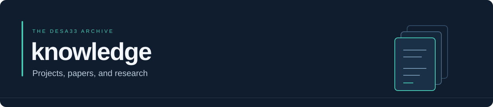

<p align="center">
  
</p>

<p align="center">
  <a href="CATALOG.md"><strong>Browse my work</strong></a> ·
  <a href="#papers--projects">Papers &amp; projects</a> ·
  <a href="#feedback">Feedback</a>
</p>

I use this repo to share papers, research, and files from the different projects I'm working on. I wanted one place where I can keep the work together, build on it, and make it easier for someone else to follow.

You'll find mathematical problems, technical ideas, project documents, and supporting notes here. I'll add more as I work through them. Each project has its own page explaining what it is, what's included, and where it currently stands.

## Papers & projects

### Broad Semantic Generalization (BSG)

I'm working on how a system can take something it learned in one environment and use it in another, even when the two represent things differently. Finding a relationship is part of it. The harder part is figuring out whether that relationship actually helps the system make better decisions.

The current paper lays out eight mathematical problems and a joint challenge covering representation, transfer, validation, and resource limits. The full problem remains open.

**Version 4.0 · 22 October 2026 · 17 pages · Working manuscript**

[**Read the paper**](BroadSematnicGenralzation%28BSG%29.pdf) · [Download PDF](BroadSematnicGenralzation%28BSG%29.pdf?raw=true) · [Project page](papers/bsg/README.md) · [Problem index](docs/bsg/PROBLEM_INDEX.md)

BSG is the first paper I've uploaded here. I'll use this repo for other projects and papers too.

## Looking for something specific?

The [catalog](CATALOG.md) lists everything I've published here, with links to the files and their versions. You can also browse the current topics:

- [Representation learning](CATALOG.md#representation-learning)
- [Transfer learning](CATALOG.md#transfer-learning)
- [Causal identification](CATALOG.md#causal-identification)

## Feedback

If you find a mistake, a gap in an argument, or a connection worth exploring, [open an issue](https://github.com/DeSa33/knowledge/issues/new/choose). Point me to the section you're looking at and explain what you found. A counterexample, derivation, or test I can run gives me something concrete to work with.

I'm interested in what holds up when an idea is tested, where it breaks, and what can be improved from there.

For a proposed change, see [CONTRIBUTING.md](CONTRIBUTING.md). If you're citing something, use the paper's title and version; each project page has more detail about the work and its source.

<details>
<summary><strong>Working with the files</strong></summary>

```bash
git clone https://github.com/DeSa33/knowledge.git
cd knowledge
python scripts/verify_repository.py
python scripts/catalog.py --check
python scripts/catalog.py --query transfer
```

The tools need Python 3.10 or later and no extra packages. On Windows, you can use `py -3` in place of `python`.

These checks cover the catalog, links, and file integrity. Research-specific evidence and limitations are documented with each project.

[Adding files](docs/ADDING_FILES.md) · [Archive guide](docs/README.md) · [Verification guide](scripts/README.md)

</details>

---

[DeSa33](https://github.com/DeSa33) · [Changelog](CHANGELOG.md) · [Rights & permissions](RIGHTS.md) · [Code of conduct](CODE_OF_CONDUCT.md) · [Security](SECURITY.md)
